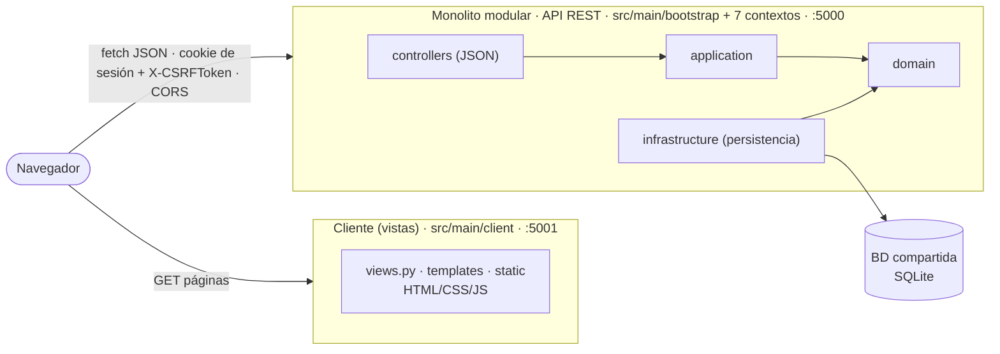
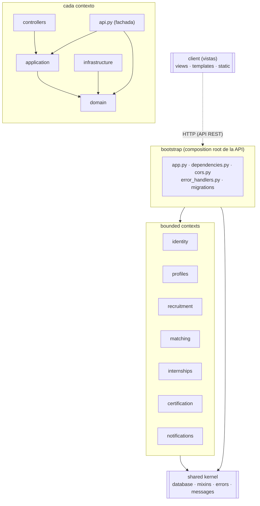
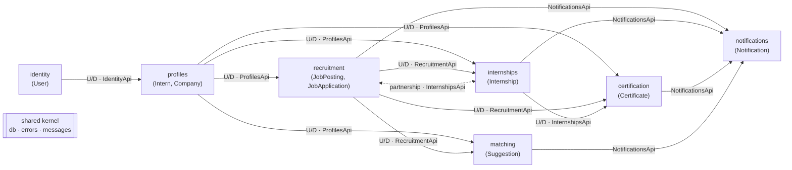

# ChambeaYa

Plataforma web para la gestión de prácticas preprofesionales, conectando estudiantes y empresas mediante postulaciones, seguimiento de procesos, recomendaciones basadas en habilidades y certificación digital de prácticas.

**Stack:** Python 3.12+ · Flask 3 · SQLAlchemy · Alembic · SQLite · Poetry · pytest · Selenium · SonarQube · Jenkins

## Inicio rápido

```bash
poetry install
cp .env.example .env            # Windows: Copy-Item .env.example .env
poetry run flask --app bootstrap.app:create_app db upgrade
poetry run flask --app bootstrap.app:create_app run --debug --port 5000   # API REST
poetry run flask --app client.app:create_app run --debug --port 5001      # cliente (otra terminal)
```

Abre el cliente en `http://127.0.0.1:5001`; la API REST queda en `http://127.0.0.1:5000`. Para una demo con datos precargados, consulta el [modo demo](#92-modo-demo).

---

## Índice

- [1. Equipo de Trabajo](#1-equipo-de-trabajo)
- [2. Propósito del Proyecto](#2-propósito-del-proyecto)
- [3. Funcionalidades](#3-funcionalidades)
  - [3.1 Diagrama de Casos de Uso UML](#31-diagrama-de-casos-de-uso-uml)
  - [3.2 Prototipo (GUI)](#32-prototipo-gui)
  - [3.3 Funcionalidades principales](#33-funcionalidades-principales)
- [4. Modelo de Dominio](#4-modelo-de-dominio)
  - [4.1 Diagrama de Clases](#41-diagrama-de-clases)
  - [4.2 Bounded Contexts](#42-bounded-contexts)
  - [4.3 Entidades](#43-entidades)
  - [4.4 Value Objects](#44-value-objects)
  - [4.5 Servicios de Dominio](#45-servicios-de-dominio)
  - [4.6 Agregados](#46-agregados)
  - [4.7 Fábricas](#47-fábricas)
  - [4.8 Repositorios](#48-repositorios)
  - [4.9 Arquitectura en Capas (dentro de cada contexto)](#49-arquitectura-en-capas-dentro-de-cada-contexto)
- [5. Visión General de Arquitectura](#5-visión-general-de-arquitectura)
  - [5.1 Diagrama de Paquetes](#51-diagrama-de-paquetes)
  - [5.2 Estructura del Proyecto](#52-estructura-del-proyecto)
  - [5.3 Clean Architecture / DDD](#53-clean-architecture--ddd)
  - [5.4 Context Map](#54-context-map)
  - [5.5 Reglas de dependencia verificadas](#55-reglas-de-dependencia-verificadas)
- [6. Prácticas de Desarrollo Aplicadas](#6-prácticas-de-desarrollo-aplicadas)
  - [6.1 Estilos de Programación](#61-estilos-de-programación)
    - [6.1.1 Things](#611-things-cosas--oop)
    - [6.1.2 Error/Exception Handling](#612-errorexception-handling)
    - [6.1.3 Persistent-Tables](#613-persistent-tables-tablas-persistentes)
    - [6.1.4 Trinity](#614-trinity-tres-capas)
    - [6.1.5 Restful](#615-restful)
  - [6.2 Convenciones de Codificación](#62-convenciones-de-codificación)
  - [6.3 Codificación Limpia (Clean Code)](#63-codificación-limpia-clean-code)
  - [6.4 Principios SOLID](#64-principios-solid)
  - [6.5 Domain-Driven Design (DDD)](#65-domain-driven-design-ddd)
    - [6.5.1 Entidades](#651-entidades)
    - [6.5.2 Objetos de Valor](#652-objetos-de-valor)
    - [6.5.3 Servicios de Dominio](#653-servicios-de-dominio)
    - [6.5.4 Agregados y Módulos](#654-agregados-y-módulos)
    - [6.5.5 Fábricas](#655-fábricas)
    - [6.5.6 Repositorios](#656-repositorios)
    - [6.5.7 Arquitectura en Capas](#657-arquitectura-en-capas)
- [7. Gestión del Proyecto](#7-gestión-del-proyecto)
  - [7.1 Tablero Trello](#71-tablero-trello)
  - [7.2 Distribución de responsabilidades](#72-distribución-de-responsabilidades)
- [8. Tecnologías](#8-tecnologías)
- [9. Ejecución local](#9-ejecución-local)
  - [9.1 Instalación y arranque](#91-instalación-y-arranque)
  - [9.2 Modo demo](#92-modo-demo)
  - [9.3 Verificación de correo (SMTP)](#93-verificación-de-correo-smtp)
- [10. Interfaz web](#10-interfaz-web)
- [11. API REST](#11-api-rest)
- [12. Persistencia y migraciones](#12-persistencia-y-migraciones)
- [13. Pruebas](#13-pruebas)
- [14. Integración y despliegue continuo (Jenkins)](#14-integración-y-despliegue-continuo-jenkins)

---

# 1. Equipo de Trabajo

| Integrante | Rango asignado | Módulo / Responsabilidad |
|------------|----------------|--------------------------|
| Omar Rivera Olivera | 1–5 | Perfil A (Joven) — UCs 1–5 |
| Edú Sucari Ccansaya | 6–10 | Perfil A (Joven) — UCs 6–10 |
| Moisés Ccaso Idme | 1–5 | Perfil B (Empresa) — UCs 1–5 |
| Jhair Torres Chávez | 1–6 | Sistema — UCs 1–6 |
| Lorenzo Quispe Torrez | 6–7 | Perfil B (Empresa) — UCs 6–7 |
| Roid Huaylla Guzman | 4–8 | Product Backlog — UCs 4–8 |

**URL del repositorio:** `https://github.com/MoisesCcaso/ChambeaYa`

---

# 2. Propósito del Proyecto

ChambeaYa tiene como propósito facilitar la gestión integral de prácticas preprofesionales mediante una plataforma web que conecte estudiantes y empresas. El sistema centraliza la publicación de convocatorias, el proceso de postulación, el seguimiento de las prácticas y la emisión de certificados digitales, optimizando la comunicación entre todos los actores involucrados.

---

# 3. Funcionalidades

## 3.1 Diagrama de Casos de Uso UML


## 3.2 Prototipo (GUI)


## 3.3 Funcionalidades principales

- Gestión de usuarios (registro, activación de cuenta, inicio de sesión, recuperación de contraseña)
- Gestión de perfiles de estudiantes y empresas (datos personales, habilidades, formación, RUC)
- Publicación y administración de convocatorias (CRUD, publicar, cerrar, reabrir, duplicar)
- Postulación a convocatorias (aplicar, cancelar, reconsiderar)
- Matching basado en habilidades (sugerencias con puntaje de compatibilidad)
- Seguimiento de prácticas (iniciar, subir entregables, registrar evaluaciones, finalizar)
- Notificaciones automáticas de eventos (selección, evaluación, certificado, sugerencias)
- Gestión y emisión de certificados digitales (PDF + QR con verificación pública)
- Validación de identidad (DNI/carnet para practicante, RUC para empresa)
- Score de reputación para practicantes
- Vista web con interfaz adaptativa para ambos roles

---

# 4. Modelo de Dominio

## 4.1 Diagrama de Clases


> El diagrama usa el lenguaje del negocio (Practicante, Convocatoria, Postulación…). En el código las clases están en inglés: `Intern`, `JobPosting`, `JobApplication`, `Internship`, `Deliverable`, `Evaluation`, `Certificate`… (ver [4.3](#43-entidades)).

## 4.2 Bounded Contexts

El sistema aplica **diseño estratégico (DDD)**: el código se divide por *bounded contexts* (módulos del negocio) y no por capas técnicas. Cada contexto es un paquete propio en `src/main/` con su modelo, sus casos de uso, su persistencia y sus endpoints. El código está en inglés; lo que ve el usuario (interfaz, mensajes, URLs y JSON) sigue en español.

| Bounded context | Paquete | Propósito | Modelo |
|-----------------|---------|-----------|--------|
| Identidad y acceso | `identity` | Registro, activación, inicio de sesión y recuperación de contraseña | `User`, `ExpiringToken` |
| Perfiles | `profiles` | Perfil de practicante y de empresa, identidad, RUC y reputación | `Intern`, `Company`, `FullName`, `RUC` |
| Reclutamiento | `recruitment` | Convocatorias (patrón State) y postulaciones | `JobPosting`, `JobPostingState`, `JobApplication` |
| Matching | `matching` | Compatibilidad entre las habilidades del practicante y los requisitos (patrón Strategy) | `Suggestion`, `MatchingStrategy` |
| Prácticas | `internships` | Ciclo de vida de la práctica, entregables y evaluaciones | `Internship`, `Deliverable`, `Evaluation` |
| Certificación | `certification` | Emisión y verificación de certificados digitales | `Certificate`, `PdfFile`, `QrCode` |
| Notificaciones | `notifications` | Avisos automáticos de eventos del sistema (subdominio genérico) | `Notification` |

Además hay dos paquetes transversales: **`shared`** (*shared kernel*: base de datos, mixins, errores de negocio y mensajes) y **`bootstrap`** (*composition root*: crea la app Flask, conecta las dependencias y sirve la interfaz web).

## 4.3 Entidades

Las entidades tienen identidad propia (id) y encapsulan comportamiento de negocio.

| Entidad | Contexto | Atributos clave | Comportamiento |
|---------|----------|-----------------|----------------|
| `User` | identity | email, password_hash, role, status, activation | register(), login(), activate(), assign_activation_token(), update_password() |
| `Intern` | profiles | first_names, last_names, dni, skills, reputation_score | update_details(), add_skill(), verify_identity(), calculate_score() |
| `Company` | profiles | legal_name, ruc, verified | verify_ruc() |
| `JobPosting` | recruitment | title, description, status, required_skills, benefits | publish(), close(), reopen(), update(), validate_deletion() |
| `JobApplication` | recruitment | status (pendiente/seleccionada/rechazada/cancelada) | select(), reject(), cancel(), reactivate(), reconsider() |
| `Suggestion` | matching | match_score, matched_skills | calculate_compatibility(), is_compatible() |
| `Internship` | internships | status (EN_CURSO/FINALIZADA), deliverables, evaluations | upload_deliverable(), register_evaluation(), finish() |
| `Deliverable` | internships | file_name, uploaded_at | create() (factory estática) |
| `Evaluation` | internships | score (0-100), evaluated_at | is_approved() (umbral ≥ 60) |
| `Notification` | notifications | notification_type, message, metadata, is_read | mark_as_read() |
| `Certificate` | certification | qr_code, document | generate_pdf(), verify_integrity(), verify_qr() |

## 4.4 Value Objects

Son objetos inmutables con validación encapsulada, sin identidad propia.

| Value Object | Contexto | Validación |
|-------------|----------|------------|
| `ExpiringToken` | identity | is_valid() — verifica la expiración contra UTC |
| `FullName` | profiles | validate() — nombres y apellidos obligatorios |
| `RUC` | profiles | is_valid() — algoritmo módulo 11 de SUNAT con prefijos 10, 15, 17, 20 |
| `PdfFile` | certification | verify_integrity() — SHA-256 del contenido |
| `QrCode` | certification | generate() + verify() con hash SHA-256 |

**Fragmento — RUC con validación SUNAT:**

```python
# src/main/profiles/domain/ruc.py
class RUC:
    def __init__(self, number=None):
        self.number = number

    def is_valid(self):
        """
        Validates the RUC number (format + check digit,
        SUNAT modulo 11 algorithm).
        """
        valid_prefixes = ("10", "15", "17", "20")
        factors = (5, 4, 3, 2, 7, 6, 5, 4, 3, 2)
        number = self.number

        if not number or not isinstance(number, str) or not number.isdigit() or len(number) != 11:
            return False

        if number[:2] not in valid_prefixes:
            return False

        digits = [int(d) for d in number[:10]]
        total = sum(d * f for d, f in zip(digits, factors))
        remainder = total % 11
        result = 11 - remainder

        if result == 10:
            check_digit = 0
        elif result == 11:
            check_digit = 1
        else:
            check_digit = result

        return check_digit == int(number[10])
```

## 4.5 Servicios de Dominio

Son clases sin estado que implementan lógica de negocio que no pertenece a una sola entidad.

| Servicio | Contexto | Métodos clave |
|----------|----------|---------------|
| `AuthenticationDomainService` | identity | generate_password_hash(), authenticate(), generate_token(), validate_token() |
| `MatchingDomainService` | matching | calculate_match(), filter_job_postings() |
| `CertificationDomainService` | certification | generate_certificate() |

**Fragmento — MatchingDomainService:**

```python
# src/main/matching/domain/matching_domain_service.py
class MatchingDomainService:
    def calculate_match(self, intern, job_posting):
        if intern is None or job_posting is None:
            return None

        suggestion = Suggestion(
            intern_id=intern.id,
            job_posting_id=job_posting.id,
            job_posting=job_posting,
            matching_strategy=self.matching_strategy,
        )
        suggestion.calculate_compatibility(
            intern.skills,
            job_posting.required_skills,
        )

        return suggestion

    def filter_job_postings(self, intern, job_postings, threshold=50.0):
        results = []
        for job_posting in job_postings:
            if job_posting.status != JobPosting.STATUS_PUBLISHED:
                continue
            suggestion = self.calculate_match(intern, job_posting)
            if suggestion is not None and suggestion.is_compatible(threshold):
                results.append(suggestion)

        return sorted(results, key=lambda r: r.match_score, reverse=True)
```

## 4.6 Agregados

Un agregado es un conjunto de entidades relacionadas donde una raíz garantiza la consistencia de las invariantes.

**Agregado `Internship`** (contexto `internships`; raíz: `Internship`, hijos: `Deliverable`, `Evaluation`):

```
Internship (raíz)
  ├── id, job_application_id, intern_id, status
  ├── Deliverable[]  — solo se acceden/modifican a través de Internship
  └── Evaluation[]   — solo se acceden/modifican a través de Internship
```

La raíz `Internship` controla todas las operaciones: no se pueden subir entregables si está finalizada, y no se puede finalizar sin entregables ni sin una evaluación aprobada. Los hijos no existen independientemente de la raíz.

## 4.7 Fábricas

Son objetos que encapsulan la creación de entidades complejas, asegurando que nazcan en un estado válido.

| Fábrica | Crea | Validaciones |
|---------|------|-------------|
| `JobPostingFactory` | `JobPosting` en estado borrador | company_id obligatorio, título obligatorio, habilidades y beneficios como lista |
| `Internship.start` (factory method) | `Internship` en estado `EN_CURSO` | job_application_id e intern_id obligatorios |

**Fragmento — JobPostingFactory:**

```python
# src/main/recruitment/domain/job_posting_factory.py
class JobPostingFactory:
    def create_job_posting(self, company_id, title, required_skills=None, description=None, benefits=None):

        if not company_id:
            raise DomainError("La empresa es obligatoria")
        title = JobPosting.normalize_title(title)
        if required_skills is not None:
            JobPosting.validate_list(required_skills, "Las habilidades requeridas")
        if benefits is not None:
            JobPosting.validate_list(benefits, "Los beneficios")

        job_posting = JobPosting()
        job_posting.company_id = company_id
        job_posting.title = str(title).strip()
        job_posting.description = (
            str(description).strip() if description is not None else None
        )
        job_posting.status = JobPosting.STATUS_DRAFT
        for skill in required_skills or []:
            job_posting.add_required_skill(skill)
        for benefit in benefits or []:
            job_posting.add_benefit(benefit)
        return job_posting
```

## 4.8 Repositorios

Cada repositorio tiene una interfaz en la capa `domain` de su contexto (contrato abstracto) y una implementación concreta en la capa `infrastructure` del mismo contexto (SQLAlchemy). Los servicios de aplicación dependen solo de la abstracción.

### Interfaces (capa domain)

| Interfaz | Contexto | Métodos |
|----------|----------|---------|
| `IUserRepository` | identity | save(), find_by_email(), find_by_id(), find_by_activation_token(), find_by_password_reset_token() |
| `IProfileRepository` (`IInternRepository` + `ICompanyRepository`) | profiles | save_intern(), save_company(), find_intern_by_user_id(), find_intern_by_id(), find_company_by_user_id() |
| `IJobPostingRepository` | recruitment | save(), find_by_id(), find_all(), search(), find_by_company_id(), delete() |
| `IJobApplicationRepository` | recruitment | save(), save_all(), find_by_id(), find_by_intern_id(), find_by_job_posting_id(), find_by_job_posting_and_intern() |
| `ISuggestionRepository` | matching | save(), find_by_intern_id() |
| `IInternshipRepository` | internships | save(), find_by_id(), find_by_intern_id(), find_by_job_application_id() |
| `INotificationWriter` | notifications | save(), mark_as_read(), mark_all_as_read() |
| `INotificationReader` | notifications | find_by_user_id(), find_unread_by_user_id(), count_unread() |
| `ICertificateRepository` | certification | save(), find_by_id(), find_by_code(), find_by_internship_id() |

### Implementaciones (capa infrastructure)

| Implementación | Interfaz(es) | Tecnología |
|----------------|-------------|------------|
| `SqlAlchemyUserRepository` | IUserRepository | SQLAlchemy + SQLite |
| `SqlAlchemyProfileRepository` | IProfileRepository | SQLAlchemy + SQLite |
| `SqlAlchemyJobPostingRepository` | IJobPostingRepository | SQLAlchemy + SQLite |
| `SqlAlchemyJobApplicationRepository` | IJobApplicationRepository | SQLAlchemy + SQLite |
| `SqlAlchemyMatchingRepository` | ISuggestionRepository | SQLAlchemy + SQLite |
| `SqlAlchemyInternshipRepository` | IInternshipRepository | SQLAlchemy + SQLite |
| `SqlAlchemyNotificationRepository` | INotificationWriter + INotificationReader | SQLAlchemy + SQLite |
| `SqlAlchemyCertificateRepository` | ICertificateRepository | SQLAlchemy + SQLite |

Los modelos ORM mapean los atributos en inglés a las columnas existentes (por ejemplo, `status = db.Column("estado", ...)`), así que el esquema de la base de datos no cambió con la traducción.

**Fragmento — Contrato + implementación:**

```python
# src/main/internships/domain/i_internship_repository.py — Interfaz (dominio)
class IInternshipRepository(ABC):
    @abstractmethod
    def save(self, internship):
        pass

    @abstractmethod
    def find_by_id(self, internship_id):
        pass

    @abstractmethod
    def find_by_intern_id(self, intern_id):
        pass

# src/main/internships/infrastructure/sqlalchemy_internship_repository.py — Implementación
class SqlAlchemyInternshipRepository(IInternshipRepository):
    def save(self, internship):
        model = None
        if internship.id is not None:
            model = db.session.get(InternshipModel, internship.id)

        if model is None:
            model = InternshipModel(
                job_application_id=internship.job_application_id,
                intern_id=internship.intern_id,
            )
            db.session.add(model)

        model.status = internship.status
        # self._sync_collection(...) sincroniza Deliverable y Evaluation
        db.session.commit()
        return self._to_internship_domain(model)

    def find_by_id(self, internship_id):
        model = db.session.get(InternshipModel, internship_id)
        return self._to_internship_domain(model)

    def _to_internship_domain(self, model):
        if model is None:
            return None
        deliverables = [Deliverable(id=e.id, internship_id=model.id, file_name=e.file_name, ...) for e in model.deliverables]
        evaluations = [Evaluation(id=ev.id, internship_id=model.id, score=ev.score, ...) for ev in model.evaluations]
        return Internship(id=model.id, ..., deliverables=deliverables, evaluations=evaluations)
```

## 4.9 Arquitectura en Capas (dentro de cada contexto)

La división principal es **por contexto**. Dentro de cada contexto se mantiene Clean Architecture con 4 capas y la regla de dependencia hacia adentro:

```
src/main/<contexto>/
┌──────────────────────────────────────────────────────┐
│  controllers    (Blueprint Flask: HTTP + JSON)        │
│  ┌──────────────────────────────────────────────────┐ │
│  │  application  (servicios de caso de uso, DTOs)   │ │
│  │  ┌──────────────────────────────────────────────┐ │ │
│  │  │  domain  (entidades, value objects,          │ │ │
│  │  │           interfaces de repositorio,         │ │ │
│  │  │           servicios de dominio)              │ │ │
│  │  └──────────────────────────────────────────────┘ │ │
│  └──────────────────────────────────────────────────┘ │
│  infrastructure (repositorios SQLAlchemy, modelos ORM,│
│                  SMTP)                                │
└──────────────────────────────────────────────────────┘
   api.py → API pública interna: fachada (IdentityApi, ProfilesApi, …) y
            entidades publicadas; lo único que otros contextos pueden usar
```

Son las capas de la arquitectura objetivo: **Controlador** (`controllers`) → **Aplicación** (`application`) → **Dominio** (`domain`) ← **Persistencia** (`infrastructure`).

**Regla de dependencia:** las capas externas dependen de las internas, nunca al revés. `controllers` → `application` → `domain`, e `infrastructure` implementa las interfaces de `domain`. El dominio no importa Flask, SQLAlchemy ni Werkzeug.

---

# 5. Visión General de Arquitectura

**Cliente (Vistas) → API REST → Monolito Modular.** Son dos aplicaciones en dos procesos y puertos distintos, que solo se comunican por HTTP:



- **Cliente** (`client.app:create_app`): solo sirve HTML, CSS y JS. No importa código del backend ni accede a la base. El JS llama a la API con `fetch(API_URL + ruta, {credentials: "include"})`, obtiene el CSRF desde `GET /auth/csrf-token` y hace en el navegador las redirecciones según la sesión (`/auth/me`).
- **API REST** (`bootstrap.app:create_app`): solo responde JSON (también los errores, incluido el 404). Acepta por CORS únicamente los orígenes de `CLIENT_ORIGINS`, con credenciales.
- **Sesión:** la API y el cliente corren en el mismo host (`127.0.0.1`) para que la cookie de sesión (`SameSite=Lax`) viaje entre los dos puertos.

| Variable | Dónde | Valor local |
|----------|-------|-------------|
| `API_URL` | cliente | `http://127.0.0.1:5000` |
| `CLIENT_ORIGINS` | API (CORS) | `http://127.0.0.1:5001` |
| `APP_URL` | API (links de correos y QR del certificado) | `http://127.0.0.1:5001` |

## 5.1 Diagrama de Paquetes

Monolito modular: una sola API Flask y una sola base de datos, divididas en bounded contexts. El cliente es un paquete aparte que no importa el backend. Las flechas indican dependencias de código permitidas.



## 5.2 Estructura del Proyecto

El código de implementación está en `src/main/` y las pruebas en `src/test/`. Ambos se organizan **por bounded context**: cada contexto tiene sus 4 capas y sus pruebas en una carpeta con el mismo nombre.

```text
ChambeaYa/
├── pyproject.toml / poetry.lock   ← dependencias y build (Poetry)
├── sonar-project.properties       ← configuración de SonarQube
├── Jenkinsfile                    ← pipeline de CI/CD
├── demo.ps1                       ← demo en Windows
├── scripts/
│   ├── demo_reset.sh              ← demo en Linux/macOS
│   └── ci/deploy.sh               ← despliegue usado por Jenkins
└── src/
    ├── main/
    │   ├── config.py
    │   ├── run.py                 ← entrada `chambeaya` (API REST)
    │   ├── client/                ← cliente (vistas), app aparte
    │   │   ├── app.py · run.py    ← create_app() y entrada `chambeaya-client`
    │   │   ├── views.py           ← rutas que solo renderizan HTML
    │   │   └── templates/ · static/   ← interfaz web (en español)
    │   ├── bootstrap/             ← composition root de la API
    │   │   ├── app.py             ← create_app()
    │   │   ├── dependencies.py    ← contenedor de dependencias (DIP) y fachadas get_*_api()
    │   │   ├── cors.py            ← CORS para el origen del cliente
    │   │   ├── error_handlers.py  ← errores → JSON con su código HTTP
    │   │   ├── routes.py · health_routes.py
    │   │   ├── models.py          ← registro de los modelos ORM
    │   │   ├── demo.py · email_cli.py
    │   │   └── migrations/        ← Alembic
    │   ├── shared/                ← shared kernel: database, mixins, errors, mensajes
    │   ├── identity/              ← cada contexto:
    │   ├── profiles/              │   ├── api.py (fachada pública)
    │   ├── recruitment/           │   ├── domain/
    │   ├── matching/              │   ├── application/
    │   ├── internships/           │   ├── infrastructure/ (repos + models/)
    │   ├── certification/         │   └── controllers/ (blueprints)
    │   └── notifications/
    └── test/
        ├── conftest.py
        ├── identity/ profiles/ recruitment/ matching/
        ├── internships/ certification/ notifications/   ← dominio, aplicación e infraestructura del contexto
        ├── shared/
        ├── bootstrap/             ← app, contenedor, errores, CORS y flujos HTTP completos
        ├── client/                ← vistas, plantillas y assets del cliente
        ├── architecture/          ← reglas de dependencia entre contextos y con el cliente
        └── functional/            ← Selenium (Page Objects)
```

## 5.3 Clean Architecture / DDD

| Paquete / capa | Responsabilidad | Depende de |
|----------------|-----------------|------------|
| **`<contexto>/domain`** | Entidades, value objects, interfaces de repositorio, servicios de dominio | `shared` y, si hace falta, el `api.py` de otro contexto |
| **`<contexto>/application`** | Casos de uso, orquestación y DTOs | Su `domain` |
| **`<contexto>/infrastructure`** | Repositorios SQLAlchemy, modelos ORM, envío de correo | Su `domain` (implementa sus interfaces) y `shared` |
| **`<contexto>/controllers`** | Blueprints Flask: HTTP, serialización JSON | Su `application`, `shared` y el contenedor de `bootstrap` (sus propios getters o las fachadas `get_*_api()` de otros contextos) |
| **`<contexto>/api.py`** | API pública interna: fachada sobre sus repositorios y servicios, y entidades publicadas | Su `domain` y su `application` |
| **`shared`** | Shared kernel: `db`, mixins, errores de negocio con su código HTTP, mensajes | Ningún contexto |
| **`bootstrap`** | Composition root de la API: crea la app, conecta repositorios, servicios y fachadas, registra blueprints, CORS y errores | Todos los contextos |
| **`client`** | Cliente (vistas): renderiza HTML y sirve CSS/JS que consumen la API REST | Solo Flask; nada del backend |

La inyección de dependencias ocurre en **`bootstrap/dependencies.py`**. Ahí se crean los objetos concretos. Cada servicio recibe sus propios repositorios y, para hablar con otro contexto, la **fachada** de ese contexto (`get_profiles_api()`, `get_recruitment_api()`, …). Así un servicio de `recruitment` busca practicantes con `profiles.find_intern_by_user_id(...)` sin conocer el repositorio ni el código de `profiles`.

| Fachada (`<contexto>/api.py`) | Métodos que usan los demás contextos |
|-------------------------------|--------------------------------------|
| `IdentityApi` | `find_user(user_id)` |
| `ProfilesApi` | `find_intern_by_user_id`, `find_intern_by_id`, `find_company_by_user_id` |
| `RecruitmentApi` | `find_job_posting`, `find_job_application`, `list_job_postings`, `job_application_ids_for_company` |
| `InternshipsApi` | `find_internship`, `find_by_job_application_id`, `get_for_user` |
| `NotificationsApi` | `notify(recipient_user_id, notification_type, message, metadata)` |

## 5.4 Context Map



| Relación | Tipo | Cómo se integran |
|----------|------|------------------|
| identity → profiles | Customer/Supplier + Published Language | `profiles` recibe `IdentityApi` (`find_user`) y usa `identity.api.User` (roles y estados) |
| profiles → recruitment, matching, internships, certification | Customer/Supplier | Reciben `ProfilesApi` por constructor (`find_intern_by_user_id`, `find_company_by_user_id`, …) |
| recruitment → matching, internships, certification | Customer/Supplier + Published Language | Reciben `RecruitmentApi`; `recruitment.api` publica además `JobPosting` y `JobApplication` |
| internships ↔ recruitment | Partnership | `recruitment` consulta `InternshipsApi.find_by_job_application_id` para saber si una postulación ya tiene práctica; `internships` lista las prácticas de una empresa con `RecruitmentApi.job_application_ids_for_company` |
| internships → certification | Customer/Supplier + Published Language | `certification` usa `InternshipsApi` (`find_internship`, `get_for_user`) e `internships.api.Internship` |
| * → notifications | Subdominio genérico (Open Host Service) | Los contextos llaman a `NotificationsApi.notify(...)` |
| todos → shared | Shared Kernel | `db`, `TimestampMixin`, `DomainError`/`NotFoundError`/…, mensajes compartidos |

Todos los contextos comparten una sola base de datos (monolito modular). Las claves foráneas entre tablas de distintos contextos se mantienen, pero ningún contexto importa los modelos ORM de otro ni consulta sus tablas: los datos de otro contexto se piden siempre por su fachada.

## 5.5 Reglas de dependencia verificadas

`src/test/architecture/test_bounded_contexts.py` analiza cada módulo con `ast` y hace fallar la suite si:

1. un contexto importa otro contexto sin pasar por su `api.py`;
2. un contexto importa `bootstrap` (salvo `controllers` → `bootstrap.dependencies`);
3. una capa `domain` depende de `application`, `infrastructure`, `controllers` o de un framework;
4. `shared` depende de un contexto o de `bootstrap`;
5. a un contexto le falta alguna de sus 4 capas, reaparece `presentation/` (ahora `controllers/`) o los paquetes por capa técnica (`application/`, `domain/`, `infrastructure/`, `frameworks/`);
6. un controlador usa un getter del contenedor de otro contexto en vez de su fachada `get_*_api()`. El dueño de cada getter se deduce de las clases que construye en `dependencies.py`;
7. un servicio armado por el contenedor recibe un repositorio o servicio de otro contexto en vez de una fachada `*Api`;
8. `client` importa el backend o el backend importa `client`;
9. `bootstrap/` vuelve a tener `templates/` o `static/`.

---

# 6. Prácticas de Desarrollo Aplicadas

## 6.1 Estilos de Programación

### 6.1.1 Things (Cosas / OOP)

Las entidades de dominio encapsulan estado y comportamiento juntos. No son DTOs anémicos — contienen las reglas de negocio que protegen sus invariantes. `Internship` gestiona su ciclo de vida (`EN_CURSO` → `FINALIZADA`) y solo permite transiciones válidas.

```python
# src/main/internships/domain/internship.py
class Internship:
    STATUS_IN_PROGRESS = "EN_CURSO"
    STATUS_FINISHED = "FINALIZADA"

    def __init__(self, id=None, job_application_id=None, intern_id=None,
                 status=None, deliverables=None, evaluations=None):
        self.id = id
        self.job_application_id = job_application_id
        self.intern_id = intern_id
        self.status = status or self.STATUS_IN_PROGRESS
        self.deliverables = deliverables or []
        self.evaluations = evaluations or []

    def upload_deliverable(self, file_name):
        if self.status == self.STATUS_FINISHED:
            raise ConflictError("No se pueden subir entregables a una práctica finalizada")

        deliverable = Deliverable.create(internship_id=self.id, file_name=file_name)
        self.deliverables.append(deliverable)
        return deliverable

    def finish(self):
        if self.status != self.STATUS_IN_PROGRESS:
            raise ConflictError("La práctica ya está finalizada")
        if not self.deliverables:
            raise ConflictError("No se puede finalizar una práctica sin entregables registrados")
        if not any(evaluation.is_approved() for evaluation in self.evaluations):
            raise ConflictError(
                "No se puede finalizar una práctica sin una evaluación aprobada"
            )

        self.status = self.STATUS_FINISHED
        return self
```

### 6.1.2 Error/Exception Handling

El dominio y la capa de aplicación lanzan **excepciones de negocio tipadas** (`src/main/shared/errors.py`); cada una lleva su código HTTP. Un único punto, `src/main/bootstrap/error_handlers.py`, las convierte en `{"error": "<mensaje>"}`. Así las rutas no repiten `try/except` y toda la API responde los errores con el mismo formato (ver [11. API REST](#11-api-rest)).

| Excepción | HTTP | Uso |
|---|---|---|
| `DomainError` | 400 | Datos inválidos o regla de validación |
| `AuthenticationError` | 401 | Credenciales inválidas |
| `ForbiddenError` | 403 | Recurso ajeno o rol que no corresponde |
| `NotFoundError` | 404 | El recurso no existe |
| `ConflictError` | 409 | El estado actual impide la acción, o el recurso está duplicado |

Todas heredan de `ValueError`, así que el código que ya captura `ValueError` sigue funcionando. Los errores de infraestructura también tienen su respuesta: `EmailDeliveryError` → 503, `IntegrityError` → 409 y, para cualquier otro error inesperado, un 500 genérico que no expone detalles internos y queda registrado en el log.

```python
# src/main/shared/errors.py
class DomainError(ValueError):
    """Invalid input or broken business rule (400 Bad Request)."""

    status_code = 400

class ConflictError(DomainError):
    """The resource's current state does not allow the operation (409 Conflict)."""

    status_code = 409

# src/main/recruitment/domain/job_posting_state.py — guard clause en el dominio
class JobPostingState(ABC):
    """State of a JobPosting (State pattern).

    Each transition returns the next state; forbidden ones raise ConflictError (409).
    The closing date belongs to the closed state only.
    """
    name = None
    closing_date = None

    def publish(self):
        raise ConflictError("Solo una convocatoria en borrador puede publicarse")

# src/main/bootstrap/error_handlers.py — traducción centralizada a HTTP
@app.errorhandler(DomainError)
def handle_domain_error(error):
    return jsonify({"error": str(error)}), error.status_code
```

### 6.1.3 Persistent-Tables (Tablas Persistentes)

Cada modelo ORM hereda de `db.Model` y mapea directamente a una tabla SQL. Las columnas usan tipos explícitos, claves foráneas, unicidad y defaults. Los campos no escalares (listas) se serializan como JSON text.

```python
# src/main/profiles/infrastructure/models/intern_model.py
class InternModel(TimestampMixin, db.Model):
    __tablename__ = "practicantes"

    id = db.Column(db.Integer, primary_key=True)
    user_id = db.Column("usuario_id", db.Integer, db.ForeignKey("usuarios.id"), unique=True, nullable=False)
    first_names = db.Column("nombres", db.String(120), nullable=True)
    last_names = db.Column("apellidos", db.String(120), nullable=True)
    dni = db.Column(db.String(20), unique=True, nullable=True)
    university_id_card = db.Column("carnet_universitario", db.String(40), unique=True, nullable=True)
    skills = db.Column("habilidades", db.Text, nullable=True)
    education = db.Column("formacion_educativa", db.Text, nullable=True)
    reputation_score = db.Column("score_reputacion", db.Float, nullable=False, default=0.0)
    identity_verified = db.Column("identidad_verificada", db.Boolean, nullable=False, default=False)

    user = db.relationship("UserModel", back_populates="intern")
```

### 6.1.4 Trinity (Tres Capas)

Cada petición cruza tres capas estrictas. **Route** (framework) construye dependencias, recibe HTTP y serializa la respuesta JSON. **Application Service** orquesta usando servicios de dominio e interfaces de repositorio. **Domain Service** aplica las reglas de negocio. Cada capa solo conoce a la inmediata inferior.

```python
# src/main/matching/controllers/matching_routes.py — Route
@matching_bp.get("/sugerencias")
def suggest_job_postings():
    """GET /matching/sugerencias — Suggested job postings for the intern."""
    user_id = session.get("usuario_id")

    if user_id is None:
        return jsonify({"error": NOT_AUTHENTICATED}), 401

    results = build_matching_service().suggest_job_postings(user_id)

    return jsonify([serialize_result(r) for r in results]), 200

def build_matching_service():
    return container.get_matching_service()

# src/main/matching/application/matching_application_service.py — Application Service
class MatchingApplicationService:
    def suggest_job_postings(self, user_id, threshold=50.0):
        self._require_repositories()

        intern = self.profiles.find_intern_by_user_id(user_id)  # ProfilesApi
        if intern is None:
            raise ForbiddenError("Practicante no encontrado")

        job_postings = self.recruitment.list_job_postings()  # RecruitmentApi
        return self.matching_domain_service.filter_job_postings(intern, job_postings, threshold)

# src/main/matching/domain/matching_domain_service.py — Domain Service
class MatchingDomainService:
    def filter_job_postings(self, intern, job_postings, threshold=50.0):
        results = []
        for job_posting in job_postings:
            if job_posting.status != JobPosting.STATUS_PUBLISHED:
                continue
            suggestion = self.calculate_match(intern, job_posting)
            if suggestion is not None and suggestion.is_compatible(threshold):
                results.append(suggestion)

        return sorted(results, key=lambda r: r.match_score, reverse=True)
```

### 6.1.5 Restful

La API usa URLs semánticas con sustantivos en plural, verbos HTTP según su propósito (POST=crear 201, GET=consultar 200, PUT=actualizar 200, DELETE=eliminar 200) y un código de estado para cada resultado: 400 validación, 401 sin sesión, 403 sin permiso, 404 no encontrado y 409 conflicto. Las acciones que cambian el estado de un recurso (`/publicar`, `/cerrar`, `/seleccionar`, …) se modelan como subrecursos con `POST`.

```python
# src/main/internships/controllers/internship_routes.py
@internship_bp.post("")
def start_internship():
    user_id = get_authenticated_user_id()
    if user_id is None:
        return jsonify({"error": NOT_AUTHENTICATED}), 401
    company = get_authenticated_company()
    if company is None:
        return jsonify({"error": COMPANY_NOT_FOUND}), 403

    job_application_id = (request.get_json(silent=True) or {}).get("postulacion_id")
    internship = build_internship_service().start_internship(company.id, job_application_id)
    return jsonify(serialize_internship(internship)), 201

@internship_bp.get("/<int:internship_id>")
def get_internship(internship_id):
    user_id = get_authenticated_user_id()
    if user_id is None:
        return jsonify({"error": NOT_AUTHENTICATED}), 401
    internship = build_internship_service().get_for_user(user_id, internship_id)
    return jsonify(serialize_internship(internship)), 200

@internship_bp.post("/<int:internship_id>/evaluar")
def register_evaluation(internship_id):
    user_id = get_authenticated_user_id()
    if user_id is None:
        return jsonify({"error": NOT_AUTHENTICATED}), 401

    company = get_authenticated_company()
    if company is None:
        return jsonify({"error": COMPANY_NOT_FOUND}), 403

    payload = request.get_json(silent=True) or {}
    internship = build_internship_service().evaluate(company.id, internship_id, payload.get("puntaje"))
    data = serialize_internship(internship)
    return jsonify(data), 201

@internship_bp.post("/<int:internship_id>/finalizar")
def finish_internship(internship_id):
    user_id = get_authenticated_user_id()
    if user_id is None:
        return jsonify({"error": NOT_AUTHENTICATED}), 401
    company = get_authenticated_company()
    if company is None:
        return jsonify({"error": COMPANY_NOT_FOUND}), 403

    data = serialize_internship(build_internship_service().finish(company.id, internship_id))
    return jsonify(data), 200
```

## 6.2 Convenciones de Codificación

### snake_case para funciones, métodos y variables

```python
# src/main/profiles/domain/intern.py
def add_skill(self, skill):
    normalized_skill = self._normalize_text(skill)
    if normalized_skill and normalized_skill not in self.skills:
        self.skills.append(normalized_skill)
    self.calculate_score()

    return self
```

### PascalCase para clases

```python
# src/main/internships/domain/internship.py
class Internship: ...

# src/main/internships/domain/evaluation.py
class Evaluation: ...
```

### UPPER_CASE para constantes de dominio

```python
# src/main/internships/domain/evaluation.py
PASSING_SCORE = 60.0

# src/main/notifications/domain/notification.py
class Notification:
    # Values are persisted and read by the frontend: they stay in Spanish.
    TYPE_JOB_APPLICATION_SELECTED = "POSTULACION_SELECCIONADA"
    TYPE_EVALUATION_AVAILABLE = "EVALUACION_DISPONIBLE"
    TYPE_CERTIFICATE_ISSUED = "CERTIFICADO_EMITIDO"
    TYPE_NEW_SUGGESTIONS = "NUEVAS_SUGERENCIAS"

    def __init__(self, id=None, recipient_user_id=None, notification_type=None, message=None,
                 metadata=None, is_read=False, created_at=None):
        self.id = id
        self.recipient_user_id = recipient_user_id
        self.notification_type = notification_type
        self.message = message
        self.metadata = metadata or {}
        self.is_read = is_read
        self.created_at = created_at

    def mark_as_read(self):
        self.is_read = True
```

### Prefijo `_` para métodos privados

```python
# src/main/recruitment/infrastructure/sqlalchemy_job_posting_repository.py
def _to_job_posting_domain(self, model): ...

def _dump_list(self, values): ...

def _load_list(self, value): ...
```

### Imports ordenados por capa arquitectónica

```python
# src/main/certification/controllers/certificate_routes.py
from io import BytesIO                                    # stdlib

import qrcode                                             # terceros
from flask import Blueprint, jsonify, send_file, session, url_for

from bootstrap.dependencies import container              # composition root
from shared.http_messages import NOT_AUTHENTICATED, COMPANY_NOT_FOUND  # shared kernel
```

## 6.3 Codificación Limpia (Clean Code)

- [6.3.1 Nombres descriptivos](#631-nombres-descriptivos)
- [6.3.2 Funciones pequeñas](#632-funciones-pequeñas-una-responsabilidad)
- [6.3.3 Docstrings en endpoints](#633-docstrings-en-endpoints)
- [6.3.4 Imports por capa](#634-imports-por-capa-arquitectónica)
- [6.3.5 Objetos con comportamiento](#635-objetos-con-comportamiento-no-anémicos)
- [6.3.6 Guard clauses + excepciones](#636-guard-clauses--excepciones)
- [6.3.7 Interfaces segregadas](#637-interfaces-segregadas)

### 6.3.1 Nombres descriptivos

Los nombres comunican intención sin requerir comentarios adicionales. El método `calculate_compatibility` describe exactamente qué hace: recibe dos listas de habilidades y calcula un score.

```python
# src/main/matching/domain/suggestion.py
def calculate_compatibility(self, intern_skills, required_skills):
    self.match_score, self.matched_skills = (
        self.matching_strategy.calculate_compatibility(
            intern_skills, required_skills
        )
    )
    return self.match_score
```

### 6.3.2 Funciones pequeñas (una responsabilidad)

Cada función hace una sola cosa. `issue_certificado()` de la ruta solo atiende HTTP y delega; `serialize_certificado()` solo transforma a dict.

```python
# src/main/certification/controllers/certificate_routes.py
@certificate_bp.post("/<int:internship_id>/emitir")
def issue_certificate_route(internship_id):
    user_id = get_authenticated_user_id()
    if user_id is None:
        return jsonify({"error": NOT_AUTHENTICATED}), 401

    profiles = container.get_profiles_api()
    company = profiles.find_company_by_user_id(user_id)
    if company is None:
        return jsonify({"error": COMPANY_NOT_FOUND}), 403

    certificate, created = build_certification_service().issue_certificate(
        company.id, internship_id
    )

    return jsonify(serialize_certificate(certificate)), 201 if created else 200

def serialize_certificate(certificate):
    return {
        "id": certificate.id,
        "practica_id": certificate.internship_id,
        "codigo_qr": {
            "valor": certificate.qr_code.value,
            "url_verificacion": (
                certificate.qr_code.verification_url
                or f"/certificados/verificar/{certificate.qr_code.value}"
            ),
            "imagen_url": f"/certificados/{certificate.qr_code.value}/qr",
        } if certificate.qr_code else None,
        "documento": {
            "url": (
                certificate.document.url
                or f"/certificados/practica/{certificate.internship_id}/pdf"
            ),
        } if certificate.document else None,
    }
```

### 6.3.3 Docstrings en endpoints

Los endpoints REST llevan docstring describiendo el método HTTP y la operación que realizan.

```python
# src/main/matching/controllers/matching_routes.py
@matching_bp.get("/sugerencias")
def suggest_job_postings():
    """GET /matching/sugerencias — Suggested job postings for the intern."""
    ...

@matching_bp.post("/calcular")
def calculate_match():
    """POST /matching/calcular — Calculate and store the intern's matches."""
    ...
```

### 6.3.4 Imports por capa arquitectónica

Los imports se organizan según la dependencia entre capas: framework → domain → application → infrastructure.

```python
# src/main/recruitment/controllers/job_application_routes.py
from flask import Blueprint, current_app, jsonify, session   # framework

from bootstrap.dependencies import container                 # composition root (inyecta los servicios)
from shared.http_messages import NOT_AUTHENTICATED, COMPANY_NOT_FOUND  # shared kernel
```

### 6.3.5 Objetos con comportamiento (no anémicos)

Las entidades no son simples contenedores de datos; encapsulan validación y lógica de negocio.

```python
# src/main/certification/domain/pdf_file.py
class PdfFile:
    @staticmethod
    def create(internship_id, content, url=None):
        if not content:
            raise DomainError("Debe proveerse el contenido del PDF para generar el archivo")

        content_bytes = content.encode() if isinstance(content, str) else content
        integrity_hash = hashlib.sha256(content_bytes).hexdigest()
        return PdfFile(
            url=url,
            integrity_hash=integrity_hash,
            content=content_bytes.decode("utf-8"),
        )

    def verify_integrity(self, content):
        if content is None or not self.integrity_hash:
            return False
        content_bytes = content.encode() if isinstance(content, str) else content
        return hashlib.sha256(content_bytes).hexdigest() == self.integrity_hash
```

### 6.3.6 Guard clauses + excepciones

Validar primero, ejecutar después. Las precondiciones se verifican al inicio del método con guard clauses cortas.

```python
# src/main/internships/domain/internship.py
def finish(self):
    if self.status != self.STATUS_IN_PROGRESS:
        raise ConflictError("La práctica ya está finalizada")
    if not self.deliverables:
        raise ConflictError("No se puede finalizar una práctica sin entregables registrados")
    if not any(evaluation.is_approved() for evaluation in self.evaluations):
        raise ConflictError(
            "No se puede finalizar una práctica sin una evaluación aprobada"
        )

    self.status = self.STATUS_FINISHED
    return self

# src/main/recruitment/domain/job_application.py
def cancel(self):
    if self.status != self.STATUS_PENDING:
        raise ConflictError("Solo una postulación pendiente puede retirarse")
    self.status = self.STATUS_CANCELLED
    return self
```

### 6.3.7 Interfaces segregadas

Interfaces pequeñas y específicas; cada cliente depende solo de los métodos que realmente usa.

```python
# src/main/notifications/domain/i_notification_writer.py
class INotificationWriter(ABC):
    @abstractmethod
    def save(self, notification):
        pass

    @abstractmethod
    def mark_as_read(self, user_id, notification_id):
        pass

    @abstractmethod
    def mark_all_as_read(self, user_id):
        pass

# src/main/notifications/domain/i_notification_reader.py
class INotificationReader(ABC):
    @abstractmethod
    def find_by_user_id(self, user_id):
        pass

    @abstractmethod
    def find_unread_by_user_id(self, user_id):
        pass

    @abstractmethod
    def count_unread(self, user_id):
        pass
```

## 6.4 Principios SOLID

- [6.4.1 SRP — Single Responsibility Principle](#641-srp--single-responsibility-principle)
- [6.4.2 OCP — Open/Closed Principle](#642-ocp--openclosed-principle)
- [6.4.3 LSP — Liskov Substitution Principle](#643-lsp--liskov-substitution-principle)
- [6.4.4 ISP — Interface Segregation Principle](#644-isp--interface-segregation-principle)
- [6.4.5 DIP — Dependency Inversion Principle](#645-dip--dependency-inversion-principle)

### 6.4.1 SRP — Single Responsibility Principle

Cada clase tiene una única razón de cambiar. `Notification` solo conoce su estado de dominio; las rutas de `notification_routes.py` solo atienden HTTP y serializan; `SqlAlchemyNotificationRepository` solo persiste.

```python
# src/main/notifications/domain/notification.py — Solo dominio
class Notification:
    TYPE_JOB_APPLICATION_SELECTED = "POSTULACION_SELECCIONADA"
    TYPE_EVALUATION_AVAILABLE = "EVALUACION_DISPONIBLE"
    TYPE_CERTIFICATE_ISSUED = "CERTIFICADO_EMITIDO"
    TYPE_NEW_SUGGESTIONS = "NUEVAS_SUGERENCIAS"

    def __init__(self, id=None, recipient_user_id=None, notification_type=None, message=None,
                 metadata=None, is_read=False, created_at=None):
        self.id = id
        self.recipient_user_id = recipient_user_id
        self.notification_type = notification_type
        self.message = message
        self.metadata = metadata or {}
        self.is_read = is_read
        self.created_at = created_at

    def mark_as_read(self):
        self.is_read = True

# src/main/notifications/controllers/notification_routes.py — Solo HTTP
@notification_bp.get("")
def list_notifications():
    user_id = get_authenticated_user_id()
    if user_id is None:
        return jsonify({"error": NOT_AUTHENTICATED}), 401

    notifications = build_notification_service().list_notifications(user_id)

    return jsonify([serialize_notification(n) for n in notifications]), 200

def serialize_notification(notification):
    return {
        "id": notification.id,
        "usuario_destino_id": notification.recipient_user_id,
        "tipo": notification.notification_type,
        "mensaje": notification.message,
        "metadata": notification.metadata,
        "leida": notification.is_read,
        "created_at": notification.created_at.isoformat() if notification.created_at else None,
    }
```

### 6.4.2 OCP — Open/Closed Principle

Para agregar un nuevo tipo de notificación solo se crea una constante en `Notification` y se invoca `NotificationsApi.notify()` desde un hook. No se modifica el ApplicationService, las rutas ni el repositorio del contexto `notifications`.

```python
# src/main/notifications/domain/notification.py — Abierto a extensión
class Notification:
    # Values are persisted and read by the frontend: they stay in Spanish.
    TYPE_JOB_APPLICATION_SELECTED = "POSTULACION_SELECCIONADA"
    TYPE_EVALUATION_AVAILABLE = "EVALUACION_DISPONIBLE"
    TYPE_CERTIFICATE_ISSUED = "CERTIFICADO_EMITIDO"
    TYPE_NEW_SUGGESTIONS = "NUEVAS_SUGERENCIAS"

    def __init__(self, id=None, recipient_user_id=None, notification_type=None, message=None,
                 metadata=None, is_read=False, created_at=None):
        self.id = id
        self.recipient_user_id = recipient_user_id
        self.notification_type = notification_type
        self.message = message
        self.metadata = metadata or {}
        self.is_read = is_read
        self.created_at = created_at

    def mark_as_read(self):
        self.is_read = True

# src/main/notifications/application/notification_application_service.py — Cerrado a modificación
class NotificationApplicationService:
    def create_notification(self, recipient_user_id, notification_type, message, metadata=None):
        notification = Notification(
            recipient_user_id=recipient_user_id,
            notification_type=notification_type,  # cualquier string funciona — no hay switch/case
            message=message,
            metadata=metadata,
        )
        return self.writer.save(notification)

# Hook en recruitment/controllers/job_application_routes.py — extensión sin modificar el contexto notifications
container.get_notifications_api().notify(
    recipient_user_id=intern.user_id,
    notification_type="POSTULACION_RECHAZADA",
    message="Tu postulación no fue seleccionada",
    metadata={"postulacion_id": job_application_id},
)
```

### 6.4.3 LSP — Liskov Substitution Principle

`SqlAlchemyNotificacionRepository` implementa tanto `INotificacionWriter` como `INotificacionReader`. La misma instancia puede inyectarse en ambos roles sin alterar el comportamiento esperado. Si se creara un `PostgresNotificacionRepository` con las mismas interfaces, podría sustituir al actual sin cambiar el ApplicationService ni las rutas.

```python
# src/main/notifications/infrastructure/sqlalchemy_notification_repository.py
class SqlAlchemyNotificationRepository(INotificationWriter, INotificationReader):
    def save(self, notification): ...

    def mark_as_read(self, user_id, notification_id): ...

    def find_by_user_id(self, user_id): ...

    def count_unread(self, user_id): ...

# src/main/notifications/controllers/notification_routes.py
def build_notification_service():
    return container.get_notification_service()
```

### 6.4.4 ISP — Interface Segregation Principle

En lugar de un `INotificacionRepository` con 6 métodos, se segregaron dos interfaces especializadas. El ApplicationService las recibe como dependencias separadas; `create_notification` solo usa `writer`, `list_notifications` solo usa `reader`.

```python
# src/main/notifications/domain/i_notification_writer.py — Solo escritura
class INotificationWriter(ABC):
    @abstractmethod
    def save(self, notification):
        pass

    @abstractmethod
    def mark_as_read(self, user_id, notification_id):
        pass

    @abstractmethod
    def mark_all_as_read(self, user_id):
        pass

# src/main/notifications/domain/i_notification_reader.py — Solo lectura
class INotificationReader(ABC):
    @abstractmethod
    def find_by_user_id(self, user_id):
        pass

    @abstractmethod
    def find_unread_by_user_id(self, user_id):
        pass

    @abstractmethod
    def count_unread(self, user_id):
        pass

# src/main/notifications/application/notification_application_service.py
class NotificationApplicationService:
    def __init__(self, writer=None, reader=None):
        self.writer = writer    # solo INotificationWriter
        self.reader = reader    # solo INotificationReader

    def create_notification(self, ...):
        self._require_writer()
        return self.writer.save(notification)   # solo usa writer

    def list_notifications(self, user_id):
        self._require_reader()
        return self.reader.find_by_user_id(user_id)  # solo usa reader
```

### 6.4.5 DIP — Dependency Inversion Principle

`NotificationApplicationService` (alta capa) depende de las abstracciones `INotificationWriter`/`INotificationReader` definidas en la capa de dominio. `SqlAlchemyNotificationRepository` (baja capa) también depende de esas mismas abstracciones al implementarlas. La inyección ocurre en el composition root (`bootstrap/dependencies.py`).

```python
# src/main/notifications/domain/i_notification_writer.py — Abstracción en dominio
class INotificationWriter(ABC):
    @abstractmethod
    def save(self, notification):
        pass

# src/main/notifications/application/notification_application_service.py — Alta capa
class NotificationApplicationService:
    def __init__(self, writer=None, reader=None):
        self.writer = writer  # depende de abstracción, no de concreción
        self.reader = reader

    def create_notification(self, ...):
        self._require_writer()
        return self.writer.save(notification)

# src/main/notifications/infrastructure/sqlalchemy_notification_repository.py — Baja capa
class SqlAlchemyNotificationRepository(INotificationWriter, INotificationReader):
    def save(self, notification):
        model = None
        if notification.id is not None:
            model = db.session.get(NotificationModel, notification.id)

        if model is None:
            model = NotificationModel(
                recipient_user_id=notification.recipient_user_id,
                notification_type=notification.notification_type,
                message=notification.message,
            )
            db.session.add(model)

        model.is_read = notification.is_read
        model.metadata_json = self._dump_json(notification.metadata)

        db.session.commit()
        return self._to_domain(model)

# src/main/notifications/controllers/notification_routes.py — Inyección
def build_notification_service():
    return container.get_notification_service()
```

## 6.5 Domain-Driven Design (DDD)

### 6.5.1 Entidades

Objetos con identidad propia (`id`) y ciclo de vida. Son mutables y encapsulan reglas de negocio.

```python
# src/main/internships/domain/internship.py
class Internship:
    STATUS_IN_PROGRESS = "EN_CURSO"
    STATUS_FINISHED = "FINALIZADA"

    def __init__(self, id=None, job_application_id=None, intern_id=None,
                 status=None, deliverables=None, evaluations=None):
        self.id = id
        self.job_application_id = job_application_id
        self.intern_id = intern_id
        self.status = status or self.STATUS_IN_PROGRESS
        self.deliverables = deliverables or []
        self.evaluations = evaluations or []

    def finish(self):
        if self.status != self.STATUS_IN_PROGRESS:
            raise ConflictError("La práctica ya está finalizada")
        if not self.deliverables:
            raise ConflictError("No se puede finalizar una práctica sin entregables registrados")
        if not any(evaluation.is_approved() for evaluation in self.evaluations):
            raise ConflictError(
                "No se puede finalizar una práctica sin una evaluación aprobada"
            )

        self.status = self.STATUS_FINISHED
        return self
```

### 6.5.2 Objetos de Valor

Inmutables, sin identidad, se comparan por su contenido. Encapsulan conceptos pequeños del dominio.

```python
# src/main/profiles/domain/full_name.py
class FullName:
    def __init__(self, first_names=None, last_names=None):
        self.first_names = first_names
        self.last_names = last_names

    def validate(self):
        first_names = str(self.first_names or "").strip()
        last_names = str(self.last_names or "").strip()
        if not first_names or not last_names:
            raise DomainError("Nombres y apellidos son obligatorios")
        self.first_names = first_names
        self.last_names = last_names
        return self

    def __str__(self):
        return f"{self.first_names} {self.last_names}".strip()

# src/main/profiles/domain/ruc.py
class RUC:
    def __init__(self, number=None):
        self.number = number

    def is_valid(self): ...
```

### 6.5.3 Servicios de Dominio

Operaciones que no pertenecen naturalmente a una sola entidad. Son stateless y coordinan varias entidades o value objects.

```python
# src/main/identity/domain/authentication_domain_service.py
class AuthenticationDomainService:
    def authenticate(self, user, password):
        if user is None:
            return False

        user.login()
        return self.password_hasher.verify(user.password_hash, password)

    def generate_token(self, valid_hours=24):
        expires_at = datetime.now(timezone.utc) + timedelta(hours=valid_hours)
        return ExpiringToken(token_urlsafe(32), expires_at)
```

### 6.5.4 Agregados y Módulos

El agregado raíz `Internship` encapsula `Deliverable` y `Evaluation` como hijos, garantizando invariantes. Los módulos son los bounded contexts del sistema (ver [4.2](#42-bounded-contexts) y [5.4 Context Map](#54-context-map)).

```python
# src/main/internships/domain/internship.py
def upload_deliverable(self, file_name):
    if self.status == self.STATUS_FINISHED:
        raise ConflictError("No se pueden subir entregables a una práctica finalizada")

    deliverable = Deliverable.create(internship_id=self.id, file_name=file_name)
    self.deliverables.append(deliverable)
    return deliverable

def register_evaluation(self, score):
    if self.status == self.STATUS_FINISHED:
        raise ConflictError("No se pueden registrar evaluaciones en una práctica finalizada")

    evaluation = Evaluation.create(internship_id=self.id, score=score)
    self.evaluations.append(evaluation)
    return evaluation
```

```
src/main/                ← un paquete por bounded context
├── identity/            ← autenticación y usuarios
├── profiles/            ← perfiles de practicante y empresa
├── recruitment/         ← convocatorias y postulaciones
├── matching/            ← sugerencias y compatibilidad
├── internships/         ← prácticas, entregables y evaluaciones
├── certification/       ← certificados, QR y PDF
└── notifications/       ← notificaciones
```

### 6.5.5 Fábricas

Encapsulan la creación de objetos complejos. Pueden ser clases dedicadas o métodos estáticos.

```python
# src/main/recruitment/domain/job_posting_factory.py
class JobPostingFactory:
    def create_job_posting(self, company_id, title, required_skills=None, description=None, benefits=None):

        if not company_id:
            raise DomainError("La empresa es obligatoria")
        title = JobPosting.normalize_title(title)
        if required_skills is not None:
            JobPosting.validate_list(required_skills, "Las habilidades requeridas")
        if benefits is not None:
            JobPosting.validate_list(benefits, "Los beneficios")

        job_posting = JobPosting()
        job_posting.company_id = company_id
        job_posting.title = str(title).strip()
        job_posting.description = (
            str(description).strip() if description is not None else None
        )
        job_posting.status = JobPosting.STATUS_DRAFT
        for skill in required_skills or []:
            job_posting.add_required_skill(skill)
        for benefit in benefits or []:
            job_posting.add_benefit(benefit)
        return job_posting

# src/main/internships/domain/deliverable.py — fábrica estática
@staticmethod
def create(internship_id, file_name):
    if not file_name or not str(file_name).strip():
        raise DomainError("Debe adjuntarse un archivo para el entregable")

    return Deliverable(
        internship_id=internship_id,
        file_name=str(file_name).strip(),
        uploaded_at=datetime.now(timezone.utc),
    )
```

### 6.5.6 Repositorios

Interfaces en el dominio que definen el contrato de persistencia; implementaciones concretas en infraestructura.

```python
# src/main/identity/domain/i_user_repository.py
class IUserRepository(ABC):
    @abstractmethod
    def save(self, user):
        pass

    @abstractmethod
    def find_by_email(self, email):
        pass

    @abstractmethod
    def find_by_id(self, user_id):
        pass

# src/main/identity/infrastructure/sqlalchemy_user_repository.py
class SqlAlchemyUserRepository(IUserRepository):
    def save(self, user):
        model = None
        if user.id is not None:
            model = db.session.get(UserModel, user.id)

        if model is None:
            model = UserModel()
            db.session.add(model)

        model.email = user.email
        model.password_hash = user.password_hash
        model.role = user.role
        model.status = user.status
        model.activation_token = user.activation_token
        model.activation_token_expires_at = user.activation_token_expires_at
        model.password_reset_token = user.password_reset_token
        model.password_reset_expires_at = user.password_reset_expires_at

        db.session.commit()
        return self._to_domain(model)
```

### 6.5.7 Arquitectura en Capas

Cada bounded context tiene cuatro capas con dependencias hacia adentro: el dominio no conoce infraestructura ni frameworks (ver [4.9](#49-arquitectura-en-capas-dentro-de-cada-contexto)).

```
src/main/identity/controllers/    ← Blueprint Flask (HTTP + serialización JSON)
src/main/identity/application/     ← Application Services (orquestación de casos de uso)
src/main/identity/infrastructure/  ← repositorios concretos, modelos ORM, email sender
src/main/identity/domain/          ← entidades, VO, servicios de dominio, interfaces de repositorio
src/main/bootstrap/                ← composition root: crea la app y conecta las capas
```

Flujo de ejemplo para registrar un usuario:

```
POST /auth/register  (identity.controllers.auth_routes.register)
  → UserApplicationService.register_user(...)
    → AuthenticationDomainService.generate_password_hash(password)
    → User.register()
    → IUserRepository.save(user)              ← interfaz
      → SqlAlchemyUserRepository.save(...)    ← implementación
        → db.session (SQLAlchemy)
```

---

# 7. Gestión del Proyecto

## 7.1 Tablero Trello

El seguimiento del proyecto se realizó mediante un tablero basado en la metodología **User Story Mapping**, organizado en Trello.

**URL del tablero:** `https://trello.com/b/OvZDZjiX/sistema-de-practicas-pre-profesionales-verificadas-unsa-2026`


## 7.2 Distribución de responsabilidades

| Integrante | Rango asignado | Módulo |
|------------|----------------|--------|
| Omar | 1–5 | Perfil A (Joven) |
| Edú | 6–10 | Perfil A (Joven) |
| Moisés | 1–5 | Perfil B (Empresa) |
| Jhair | 1–6 | Sistema |
| Lorenzo | 6–7 | Perfil B (Empresa) |
| Lorenzo | 1–3 | Product Backlog |
| Roid | 4–8 | Product Backlog |

---

# 8. Tecnologías

| Área | Herramientas |
|------|--------------|
| Lenguaje | Python 3.12 o superior |
| Web | API REST con Flask 3 y Flask-WTF (CSRF), CORS propio; cliente aparte con Flask, plantillas Jinja, CSS y JavaScript nativo |
| Persistencia | SQLAlchemy, Flask-SQLAlchemy, Alembic, Flask-Migrate, SQLite |
| Documentos | ReportLab (PDF) y QRCode |
| Dependencias y build | Poetry 2.4.3 |
| Pruebas | pytest, pytest-cov, pytest-html, Selenium WebDriver |
| Calidad | Ruff, SonarQube |
| CI/CD | Jenkins |

---

# 9. Ejecución local

El proyecto requiere **Python 3.12 o superior** y **Poetry 2.4.3**, la versión registrada en `poetry.lock`.

- `.venv` es el entorno de Python del proyecto. Poetry lo crea dentro del repositorio porque `poetry.toml` configura `virtualenvs.in-project = true`.
- `.env` es un archivo distinto: contiene la configuración local de Flask, como la clave secreta y los datos SMTP. No se sube al repositorio.
- Las dependencias se declaran solo en `pyproject.toml`. Si algún entorno exige un `requirements.txt`, se genera en el momento con `poetry export -f requirements.txt -o requirements.txt` (requiere el plugin `poetry-plugin-export`) y no se versiona.

## 9.1 Instalación y arranque

**Windows (PowerShell):**

```powershell
poetry install
Copy-Item .env.example .env
poetry run flask --app bootstrap.app:create_app db upgrade
poetry run flask --app bootstrap.app:create_app run --debug --port 5000   # terminal 1: API REST
poetry run flask --app client.app:create_app run --debug --port 5001      # terminal 2: cliente
```

**Linux o macOS:**

```bash
poetry install
cp .env.example .env
poetry run flask --app bootstrap.app:create_app db upgrade
poetry run flask --app bootstrap.app:create_app run --debug --port 5000   # terminal 1: API REST
poetry run flask --app client.app:create_app run --debug --port 5001      # terminal 2: cliente
```

El cliente queda en `http://127.0.0.1:5001` y la API REST en `http://127.0.0.1:5000`. Desde el wheel, los mismos procesos se inician con `chambeaya` (API) y `chambeaya-client` (cliente). Para comprobarlos:

```bash
curl http://127.0.0.1:5000/health
# {"service":"ChambeaYa","status":"ok"}
curl -I http://127.0.0.1:5001/
# HTTP/1.1 200 OK
```

**Instalar la versión correcta de Poetry.** Comprueba que `poetry --version` muestre exactamente `2.4.3` antes de instalar las dependencias. En Ubuntu, si la versión del sistema es antigua, instala la requerida con pipx y usa su ruta explícita para no seleccionar la de `/usr/bin/poetry`:

```bash
# El sudo se usa solo para instalar pipx desde los paquetes de Ubuntu.
sudo apt install pipx
pipx ensurepath
pipx install "poetry==2.4.3"
~/.local/bin/poetry --version
~/.local/bin/poetry install
```

En Windows y macOS, instala Poetry 2.4.3 siguiendo la [guía oficial de instalación](https://python-poetry.org/docs/#installation).

## 9.2 Modo demo

La demo usa una base SQLite independiente (`instance/chambeaya-demo.db`) con datos precargados. No modifica `chambeaya.db` ni requiere servicios externos. Los scripts levantan la API REST en `http://127.0.0.1:5000`, en segundo plano, y el cliente en `http://127.0.0.1:5001`, que es el que se abre en el navegador. `Ctrl+C` detiene ambos.

| Sistema | Iniciar | Reiniciar los datos e iniciar |
|---------|---------|-------------------------------|
| Windows (PowerShell) | `.\demo.ps1` | `.\demo.ps1 -Reset` |
| Linux / macOS | `scripts/demo_reset.sh --no-reset` | `scripts/demo_reset.sh` |

El reinicio elimina únicamente `instance/chambeaya-demo.db`, vuelve a aplicar las migraciones y restaura el escenario inicial. Úsalo antes de presentar si en un ensayo se finalizaron prácticas, se emitieron certificados o se modificaron datos.

En el login aparecen accesos rápidos que completan las credenciales:

| Rol | Correo | Contraseña |
|-----|--------|------------|
| Practicante | `practicante@demo.local` | `Demo1234` |
| Empresa | `empresa@demo.local` | `Demo1234` |

La contraseña sale de la variable `DEMO_PASSWORD`. Los scripts la definen como `Demo1234` si no existe. Si ejecutas `flask seed-demo` a mano, agrega `DEMO_PASSWORD=Demo1234` a tu `.env` (ver `.env.example`).

En modo demo los tokens de activación y recuperación se muestran en pantalla, así que no hace falta configurar correo.

### Recorrido recomendado

**1. Vista pública**

1. Mostrar la landing.
2. Abrir la validación pública de certificados.
3. Explicar el registro separado para practicantes y empresas.

**2. Practicante**

1. En el login, pulsar **Practicante** e ingresar.
2. Mostrar el resumen y el perfil verificado de Andrea Quispe.
3. Explorar las convocatorias publicadas.
4. Abrir **Para ti** para mostrar el matching por habilidades.
5. Mostrar las postulaciones seleccionada y pendiente.
6. Abrir la práctica para enseñar el entregable y la evaluación de 85 puntos.
7. Revisar las notificaciones.
8. Cerrar sesión.

**3. Empresa**

1. En el login, pulsar **Empresa** e ingresar.
2. Mostrar las convocatorias publicadas y el borrador editable.
3. Abrir los candidatos de la convocatoria de calidad.
4. Seleccionar al candidato e iniciar una nueva práctica si se desea.
5. Abrir la práctica backend existente.
6. Finalizarla: ya cuenta con entregable y evaluación aprobada.
7. Emitir el certificado y abrir el PDF y el QR.
8. Cerrar sesión.

**4. Certificado público**

1. Copiar el código emitido.
2. Cerrar sesión.
3. Abrir `/verificar-certificado`.
4. Validar el código para demostrar la consulta pública de integridad.

### Problemas frecuentes

- **El puerto 5000 o 5001 está ocupado:** detén la otra aplicación con `Ctrl+C`.
- **Cambió el esquema de la base:** vuelve a iniciar la demo con reinicio (`.\demo.ps1 -Reset` o `scripts/demo_reset.sh`).

## 9.3 Verificación de correo (SMTP)

Las cuentas nuevas permanecen en estado `pendiente` hasta que el usuario abre el enlace de activación enviado a su correo. Para usar un servidor SMTP real, configura en `.env`:

```env
APP_URL=http://127.0.0.1:5001
MAIL_DELIVERY_MODE=smtp
MAIL_SERVER=smtp.tu-proveedor.com
MAIL_PORT=587
MAIL_USERNAME=tu_usuario_smtp
MAIL_PASSWORD=tu_clave_smtp
MAIL_USE_TLS=true
MAIL_USE_SSL=false
MAIL_SENDER=ChambeaYa <no-reply@tu-dominio.com>
EXPOSE_AUTH_TOKENS=false
```

`APP_URL` debe ser la dirección del **cliente**, desde la que el usuario abre la aplicación. Los enlaces de activación y recuperación, y el QR del certificado, apuntan a sus vistas. Si el correo se abre en otro dispositivo, usa una dirección de red o una URL pública en lugar de `127.0.0.1`.

En los modos `console` y `demo` los tokens pueden exponerse para facilitar las pruebas locales. Ese comportamiento debe permanecer desactivado cuando se envían correos reales.

Para comprobar la conexión después de configurar SMTP:

```bash
poetry run flask --app bootstrap.app:create_app test-email --to tu_correo@gmail.com
```

No uses la contraseña normal de Gmail ni subas el archivo `.env` al repositorio.

---

# 10. Interfaz web

La interfaz es el **cliente**: una app Flask aparte (`src/main/client`, puerto 5001) que solo sirve plantillas Jinja, CSS y JavaScript nativo. No requiere un proceso de compilación adicional y no importa código del backend.

| Ruta | Vista |
|------|-------|
| `/` | Página de presentación |
| `/ingresar` | Inicio de sesión |
| `/registro` | Registro con confirmación y requisitos de contraseña |
| `/activar` | Activación mediante el enlace enviado al correo, y reenvío |
| `/recuperar` | Solicitud de recuperación de contraseña |
| `/restablecer` | Restablecimiento de contraseña |
| `/verificar-certificado` | Validación pública de certificados |
| `/app` | Aplicación autenticada según el rol |

La ruta `/app` detecta el rol de la sesión y presenta únicamente sus funciones:

- **Practicante:** perfil, oportunidades, sugerencias, postulaciones, prácticas, entregables, evaluaciones, certificados y notificaciones.
- **Empresa:** perfil, convocatorias, candidatos, selección, prácticas, evaluaciones, emisión de certificados y notificaciones.

Las vistas consumen los endpoints de la [API REST](#11-api-rest) por HTTP: `common.js` antepone `window.CHAMBEAYA_API_URL` (valor de `API_URL`) a cada ruta, envía la cookie de sesión con `credentials: "include"` y obtiene el token CSRF desde `GET /auth/csrf-token`. Lo renueva después del login y del logout. Los links que devuelve la API (entregables, PDF y QR del certificado) se arman con `Chambea.apiUrl()`. Como el cliente no ve la sesión, las redirecciones las hace el JS: `/app` vuelve a `/ingresar` si `/auth/me` responde 401, e `/ingresar` y `/registro` pasan a `/app` si ya hay sesión. Los errores de validación y de autorización se muestran en contexto, y las acciones incluyen estados de carga, confirmaciones y estados vacíos.

**Diseño.** Paleta sobria de azul profundo y grises fríos, con `#0062fc` como color primario, tomado de la identidad gráfica de ChambeaYa. No usa degradados. Las pantallas priorizan tablas, listas y secciones amplias sobre grupos repetitivos de tarjetas, con navegación adaptable para escritorio, tableta y móvil.

| Archivo | Contenido |
|---------|-----------|
| `src/main/client/app.py` · `views.py` | App del cliente y rutas de las vistas |
| `src/main/client/templates/` | Estructura de las vistas |
| `src/main/client/static/css/app.css` | Sistema visual y responsive |
| `src/main/client/static/icons.svg` | Iconografía SVG reutilizable |
| `src/main/client/static/img/` | Logos horizontal y cuadrado |
| `src/main/client/static/js/common.js` | Utilidades y cliente HTTP de la API (URL base, cookie, CSRF) |
| `src/main/client/static/js/app.js` | Interacción de la aplicación |
| `src/main/client/static/js/auth.js` | Flujos de autenticación |
| `src/main/client/static/js/verify.js` | Validación de certificados |

---

# 11. API REST

El backend expone una API REST en JSON (Flask, puerto 5000). Todos los endpoints, incluidos los errores, responden JSON y comparten las mismas convenciones de autenticación, CSRF y errores. Por eso la API se puede probar de punta a punta con `curl`, Postman o cualquier cliente HTTP. El navegador la usa desde el cliente (`:5001`) gracias a CORS: solo los orígenes de `CLIENT_ORIGINS` reciben `Access-Control-Allow-Origin` y `Allow-Credentials`, y el preflight `OPTIONS` responde 200.

### Cómo probar la API

1. **Sesión por cookie.** `POST /auth/login` devuelve una cookie de sesión que el cliente debe reenviar en las siguientes peticiones; con `curl` usa `-c cookies.txt -b cookies.txt`.
2. **Token CSRF en escrituras.** Todo `POST`, `PUT` y `DELETE` exige la cabecera `X-CSRFToken`. El token se obtiene con `GET /auth/csrf-token` (respuesta `{"csrf_token": "..."}`) usando la misma cookie. Después de iniciar o cerrar sesión hay que pedir un token nuevo, porque la sesión se reinicia.
3. **Cuerpo JSON** con `Content-Type: application/json`, salvo la subida de entregables (`multipart/form-data`, campo `archivo`).
4. **Datos de prueba:** `scripts/demo_reset.sh` (o `demo.ps1`) levanta la app con cuentas demo (`practicante@demo.local` y `empresa@demo.local`, contraseña `DEMO_PASSWORD`). En ese modo, registro y recuperación devuelven los tokens (`activation_token`, `password_reset_token`) en la respuesta.

```bash
BASE=http://127.0.0.1:5000
csrf() { curl -s -b cookies.txt -c cookies.txt "$BASE/auth/csrf-token" | python3 -c "import sys, json; print(json.load(sys.stdin)['csrf_token'])"; }

curl -X POST "$BASE/auth/login" -b cookies.txt -c cookies.txt \
  -H "Content-Type: application/json" -H "X-CSRFToken: $(csrf)" \
  -d '{"email":"empresa@demo.local","password":"Demo1234"}'
```

### Formato de errores y códigos de estado

Todos los errores de la API responden con el mismo cuerpo JSON y un mensaje en español:

```json
{"error": "Convocatoria no encontrada"}
```

| Código | Cuándo | Ejemplo |
|---|---|---|
| 200 / 201 | Consulta o acción correcta / recurso creado | `POST /convocatorias` → 201 |
| 400 | Datos inválidos o faltantes, token CSRF ausente | `{"error": "El título es obligatorio"}` |
| 401 | Sin sesión o credenciales inválidas | `{"error": "No autenticado"}` |
| 403 | Sesión válida, pero sin permiso: el recurso es de otro usuario o el rol no corresponde | `{"error": "La convocatoria no pertenece a esta empresa"}` |
| 404 | El recurso o la ruta no existe | `{"error": "Postulación no encontrada"}` |
| 405 | Método HTTP no permitido en la ruta | `{"error": "Método no permitido para este recurso"}` |
| 409 | El estado actual impide la acción o el recurso ya existe | `{"error": "Solo una convocatoria en borrador puede publicarse"}` |
| 413 | Archivo de más de 10 MB | `{"error": "El archivo excede el límite de 10 MB"}` |
| 500 | Error inesperado; el detalle queda en el log del servidor y no se expone | `{"error": "Error interno del servidor"}` |
| 503 | No se pudo enviar el correo (SMTP) | `{"error": "No se pudo enviar el correo..."}` |

### Salud

| Método | Ruta | Uso |
|---|---|---|
| GET | `/health` | Comprobar que la aplicación responde |

### Autenticación

| Método | Ruta | Uso |
|---|---|---|
| GET | `/auth/csrf-token` | Obtener el token CSRF para las escrituras |
| POST | `/auth/register` | Registrar empresa o practicante |
| POST | `/auth/activate` | Activar la cuenta |
| POST | `/auth/resend-activation` | Reenviar el enlace de activación |
| POST | `/auth/login` | Iniciar sesión |
| GET | `/auth/me` | Consultar el usuario autenticado |
| POST | `/auth/logout` | Cerrar sesión |
| POST | `/auth/recover-password` | Solicitar recuperación de contraseña |
| POST | `/auth/reset-password` | Cambiar la contraseña con un token |

Los tokens (`activation_token`, `password_reset_token`) se incluyen en la respuesta solo cuando `EXPOSE_AUTH_TOKENS=true` (desarrollo, demo y pruebas). Con SMTP, el token llega dentro del enlace enviado al correo.

```bash
# Registro
curl -X POST "$BASE/auth/register" \
  -b cookies.txt -c cookies.txt \
  -H "Content-Type: application/json" -H "X-CSRFToken: $(csrf)" \
  -d '{"email":"practicante@example.com","password":"Secret123","password_confirmation":"Secret123","tipo":"practicante"}'

# Activación
curl -X POST "$BASE/auth/activate" \
  -b cookies.txt -c cookies.txt \
  -H "Content-Type: application/json" -H "X-CSRFToken: $(csrf)" \
  -d '{"token":"TOKEN_DE_ACTIVACION"}'

# Reenviar el enlace de activación
curl -X POST "$BASE/auth/resend-activation" \
  -b cookies.txt -c cookies.txt \
  -H "Content-Type: application/json" -H "X-CSRFToken: $(csrf)" \
  -d '{"email":"practicante@example.com"}'

# Inicio de sesión (guarda la cookie)
curl -X POST "$BASE/auth/login" \
  -b cookies.txt -c cookies.txt \
  -H "Content-Type: application/json" -H "X-CSRFToken: $(csrf)" \
  -d '{"email":"practicante@example.com","password":"Secret123"}'

# Usuario autenticado
curl -b cookies.txt "$BASE/auth/me"

# Cierre de sesión
curl -X POST "$BASE/auth/logout" -b cookies.txt -c cookies.txt -H "X-CSRFToken: $(csrf)"

# Solicitud de recuperación de contraseña
curl -X POST "$BASE/auth/recover-password" \
  -b cookies.txt -c cookies.txt \
  -H "Content-Type: application/json" -H "X-CSRFToken: $(csrf)" \
  -d '{"email":"practicante@example.com"}'

# Restablecimiento de contraseña
curl -X POST "$BASE/auth/reset-password" \
  -b cookies.txt -c cookies.txt \
  -H "Content-Type: application/json" -H "X-CSRFToken: $(csrf)" \
  -d '{"token":"TOKEN_DE_RECUPERACION","new_password":"nuevaClave123"}'
```

### Perfiles

| Método | Ruta | Uso |
|---|---|---|
| GET | `/perfil/me` | Obtener el perfil según el tipo de usuario |
| PUT | `/perfil/me` | Crear o actualizar el perfil de practicante |
| PUT | `/perfil/me/empresa` | Crear o actualizar la empresa y validar el RUC |
| POST | `/perfil/me/habilidades` | Añadir una habilidad |
| POST | `/perfil/me/formacion` | Añadir formación educativa |
| POST | `/perfil/me/identidad` | Registrar y verificar DNI o carnet |
| GET | `/perfil/me/reputacion` | Consultar el score de reputación |

```bash
# Perfil del usuario autenticado
curl -b cookies.txt "$BASE/perfil/me"

# Crear o actualizar perfil de practicante
curl -X PUT "$BASE/perfil/me" \
  -b cookies.txt -c cookies.txt \
  -H "Content-Type: application/json" -H "X-CSRFToken: $(csrf)" \
  -d '{"nombres":"Diego","apellidos":"Perez","habilidades":["Python"],"formacion_educativa":["Ingenieria de Sistemas"]}'

# Agregar habilidad
curl -X POST "$BASE/perfil/me/habilidades" \
  -b cookies.txt -c cookies.txt \
  -H "Content-Type: application/json" -H "X-CSRFToken: $(csrf)" \
  -d '{"habilidad":"Flask"}'

# Agregar formación educativa
curl -X POST "$BASE/perfil/me/formacion" \
  -b cookies.txt -c cookies.txt \
  -H "Content-Type: application/json" -H "X-CSRFToken: $(csrf)" \
  -d '{"formacion":"UNSA"}'

# Registrar y verificar identidad
curl -X POST "$BASE/perfil/me/identidad" \
  -b cookies.txt -c cookies.txt \
  -H "Content-Type: application/json" -H "X-CSRFToken: $(csrf)" \
  -d '{"dni":"12345678","carnet_universitario":"20260001"}'

# Consultar score de reputación
curl -b cookies.txt "$BASE/perfil/me/reputacion"
```

### Convocatorias y matching

| Método | Ruta | Uso |
|---|---|---|
| GET | `/convocatorias?q=python` | Buscar convocatorias publicadas |
| GET | `/convocatorias/<id>` | Ver una convocatoria publicada |
| GET | `/convocatorias/mis` | Listar las convocatorias de la empresa |
| POST | `/convocatorias` | Crear un borrador |
| PUT | `/convocatorias/<id>` | Editar un borrador propio |
| DELETE | `/convocatorias/<id>` | Eliminar un borrador propio |
| POST | `/convocatorias/<id>/publicar` | Publicar un borrador |
| POST | `/convocatorias/<id>/cerrar` | Cerrar una convocatoria |
| POST | `/convocatorias/<id>/reabrir` | Reabrir una convocatoria cerrada (vuelve a publicada) |
| POST | `/convocatorias/<id>/duplicar` | Duplicar como nuevo borrador ("Copia de …") |
| GET | `/matching/sugerencias` | Calcular sugerencias sin persistir |
| POST | `/matching/calcular` | Calcular y guardar sugerencias |

El matching compara habilidades sin distinguir mayúsculas y solo considera convocatorias publicadas.

### Postulaciones

| Método | Ruta | Uso |
|---|---|---|
| POST | `/postulaciones/convocatorias/<id>` | Postular a una convocatoria |
| GET | `/postulaciones/me` | Listar las postulaciones del practicante |
| POST | `/postulaciones/<id>/cancelar` | Retirar una postulación pendiente (practicante) |
| GET | `/postulaciones/convocatorias/<id>` | Listar los candidatos de la empresa |
| POST | `/postulaciones/<id>/seleccionar` | Seleccionar a un candidato |
| POST | `/postulaciones/<id>/rechazar` | Rechazar a un candidato |
| POST | `/postulaciones/<id>/reconsiderar` | Devolver a pendiente una postulación seleccionada o rechazada, si aún no se inició la práctica |

No se permiten postulaciones duplicadas. Al seleccionar a un candidato, las demás postulaciones pendientes de la convocatoria se rechazan.

### Prácticas, entregables y evaluaciones

| Método | Ruta | Uso |
|---|---|---|
| POST | `/practicas` | Iniciar una práctica desde una postulación seleccionada |
| GET | `/practicas` | Listar las prácticas visibles para el usuario |
| GET | `/practicas/<id>` | Consultar una práctica autorizada |
| POST | `/practicas/<id>/entregables` | Subir PDF, DOC, DOCX o ZIP (máx. 10 MB) |
| GET | `/practicas/<id>/entregables` | Historial de entregables |
| GET | `/practicas/<id>/entregables/<id>/archivo` | Descargar un entregable |
| DELETE | `/practicas/<id>/entregables/<id>` | Eliminar un entregable |
| POST | `/practicas/<id>/evaluar` | Registrar una evaluación de 0 a 100 |
| GET | `/practicas/<id>/evaluaciones` | Historial de evaluaciones |
| DELETE | `/practicas/<id>/evaluaciones/<id>` | Eliminar una evaluación (empresa) |
| POST | `/practicas/<id>/finalizar` | Finalizar la práctica |

Para finalizar se exige al menos un entregable y una evaluación aprobada (puntaje mínimo: 60).

```bash
# Subir un entregable (en PowerShell usa curl.exe y ` para continuar la línea)
curl -X POST "$BASE/practicas/1/entregables" \
  -b cookies.txt -H "X-CSRFToken: $(csrf)" \
  -F "archivo=@informe.pdf"
```

### Notificaciones y certificados

| Método | Ruta | Uso |
|---|---|---|
| GET | `/notificaciones` | Listar las notificaciones propias |
| GET | `/notificaciones/no-leidas` | Contar las no leídas |
| PUT | `/notificaciones/<id>/leer` | Marcar una notificación propia como leída |
| PUT | `/notificaciones/leer-todas` | Marcar todas como leídas |
| POST | `/certificados/<practica_id>/emitir` | Emitir el certificado |
| GET | `/certificados/practica/<practica_id>` | Consultar un certificado autorizado |
| GET | `/certificados/verificar/<codigo>` | Verificación pública |
| GET | `/certificados/practica/<practica_id>/pdf` | Descargar el PDF |
| GET | `/certificados/<codigo>/qr` | Descargar el QR |

La emisión es idempotente: una práctica tiene como máximo un certificado. La verificación comprueba tanto el QR como la integridad del contenido persistido.

---

# 12. Persistencia y migraciones

- La base SQLite de desarrollo vive en `instance/chambeaya.db`, y la de la demo en `instance/chambeaya-demo.db`.
- Los entregables subidos se guardan en `instance/uploads/entregables`.
- Las claves foráneas de SQLite se habilitan en cada conexión.
- La revisión `9f12c0a8d4e1` completa el esquema de todas las funcionalidades.
- `instance/` está ignorado por Git y no debe versionarse.

El entorno de migraciones está en `src/main/bootstrap/migrations`. Ejecuta los comandos desde el entorno Poetry del proyecto:

```bash
# Crear una migración después de modificar modelos
poetry run flask --app bootstrap.app:create_app db migrate -m "descripcion del cambio"

# Aplicar migraciones
poetry run flask --app bootstrap.app:create_app db upgrade

# Revertir la última migración
poetry run flask --app bootstrap.app:create_app db downgrade
```

Para reiniciar la base de desarrollo, detén la aplicación, elimina únicamente `instance/chambeaya.db` y vuelve a ejecutar `db upgrade`.

---

# 13. Pruebas

La suite está en `src/test/` y se divide por bounded context:

| Carpeta | Tipo | Necesita la app levantada |
|---------|------|---------------------------|
| `identity/`, `profiles/`, `recruitment/`, `matching/`, `internships/`, `certification/`, `notifications/`, `shared/` | Unitarias y de repositorio (dominio, aplicación e infraestructura de cada contexto) | No |
| `architecture/` | Reglas de dependencia entre contextos y capas | No |
| `bootstrap/` | Integración: app, contenedor, manejo de errores, plantillas y flujos HTTP completos con SQLite en memoria | No |
| `functional/` | Funcionales de caja negra con Selenium | Sí, en modo demo |

pytest descubre tanto las clases `unittest.TestCase` como las pruebas pytest. Los comandos funcionan igual en PowerShell, Linux y macOS.

**Unitarias e integración** (no requieren navegador ni app):

```sh
poetry run pytest --ignore=src/test/functional
```

**Con cobertura.** El XML lo usa SonarQube; el HTML es para revisarla en el navegador:

```sh
poetry run pytest --ignore=src/test/functional --cov --cov-report=xml --cov-report=html
# reports/coverage.xml y reports/htmlcov/index.html
```

**Funcionales (Selenium).** Primero levanta la [demo](#92-modo-demo) en otra terminal y luego ejecuta:

```sh
poetry run pytest src/test/functional
```

La guía completa de las funcionales (Page Objects, reportes HTML, casos de prueba y cómo usar otra URL) está en [`src/test/functional/README.md`](src/test/functional/README.md).

`poetry run pytest` sin argumentos ejecuta **toda** la suite, funcionales incluidas, así que necesita la demo levantada.

---

# 14. Integración y despliegue continuo (Jenkins)

El `Jenkinsfile` de la raíz define el pipeline. Jenkins lo ejecuta automáticamente cuando detecta cambios en la rama configurada (*Poll SCM*):

| # | Etapa | Qué hace | Si falla |
|---|-------|----------|----------|
| 1 | Build (Poetry) | `poetry install` y `poetry build`. Archiva el wheel | Se detiene |
| 2 | Pruebas unitarias | pytest sin funcionales, con cobertura y reporte JUnit | Se detiene |
| 3 | Análisis SonarQube | `sonar-scanner` con `sonar-project.properties` | Se detiene |
| 4 | Quality Gate | Espera el veredicto de SonarQube (máx. 5 min) | Se detiene |
| 5 | Staging efímero | Instala el wheel en el workspace con BD nueva: API en `127.0.0.1:5002`, cliente en `127.0.0.1:5003` | Se detiene |
| 6 | Pruebas funcionales | Selenium contra el cliente de staging (`CHAMBEAYA_BASE_URL`), con los datos de prueba creados por la API (`CHAMBEAYA_API_URL`) | Se detiene |
| 7 | OWASP ZAP Full Scan | Ejecuta Full Scan del cliente (`:5003`) y API Scan sobre las operaciones de `:5002/openapi.json`; archiva reportes HTML y JSON. Solo las alertas High bloquean el pipeline | Se detiene y no despliega |
| 8 | Despliegue | Instala el mismo wheel en `$JENKINS_HOME/chambeaya`: API en `127.0.0.1:5000`, cliente en `127.0.0.1:5001` (los mismos puertos que en local) | Rollback automático |

El agente Jenkins necesita Docker y debe ejecutarse en Linux: ZAP usa `--network host` para acceder a los puertos loopback del staging. Para contener el consumo en CI, cada escaneo tiene un límite de 2 CPU y 2 GB de RAM; ZAP usa como máximo 2 hilos por host y limita cada regla activa a 1 minuto y cada Active Scan a 5 minutos. El Full Scan del cliente además limita a 3 minutos el spider tradicional (`-m 3`) y omite el spider moderno. Estos límites acortan la cobertura frente a un análisis sin límite. Para la API, `zap-api-scan.py` importa `/openapi.json` y ejecuta Active Scan sobre las operaciones descritas. La API sirve ese documento desde sus blueprints REST registrados; se puede consultar en `http://127.0.0.1:5002/openapi.json` durante el staging (o en el puerto de la API local). `servers` se genera con el host y puerto que atendieron la solicitud, por lo que ZAP apunta al mismo staging (`:5002`) y no al despliegue final (`:5000`). Ambos escaneos envían payloads de ataque y pueden modificar datos; sus objetivos son solo el staging efímero, que se elimina al finalizar el pipeline. Los reportes `zap-client.html`, `zap-client.json`, `zap-api.html` y `zap-api.json` se archivan incluso si el escaneo o el gate falla. Solo las alertas High bloquean el despliegue.

**Despliegue (`scripts/ci/deploy.sh`).** Lo usan staging y el despliegue final:

- Cada versión se instala en `releases/<timestamp>`, y el symlink `current` apunta a la activa. Se conservan la versión activa y la anterior.
- La base de datos persiste entre despliegues: solo se aplican `db upgrade` y `seed-demo` (que es idempotente). Antes de migrar se respalda.
- Uso: `deploy.sh <dir> <api_port> <client_port>`. Levanta `chambeaya` (API) y `chambeaya-client` (cliente) con `API_URL`, `APP_URL` y `CLIENT_ORIGINS` coherentes.
- Si la versión nueva no responde (API en `/health` y cliente en `/`), se restauran la versión anterior y su base de datos.
- El servidor corre en modo demo y solo en localhost, porque `ProductionConfig` exige cookies `Secure` (HTTPS).

**Configuración necesaria en Jenkins:**

- Plugins: SonarQube Scanner, JUnit, Pipeline, Workspace Cleanup y Timestamper. El agente Linux también necesita Docker disponible para el escaneo ZAP.
- **Manage Jenkins → System → SonarQube servers:** un servidor llamado `SonarQube`, con la URL de SonarQube y una credencial *Secret text* `sonar-token`.
- **Manage Jenkins → Tools:** un *SonarQube Scanner* llamado `sonar-scanner`.
- **En SonarQube:** un webhook hacia `http://<jenkins>/sonarqube-webhook/`. Si Jenkins y SonarQube corren en la misma máquina, agrega `sonar.validateWebhooks=false` a `conf/sonar.properties`.
- **El job:** *Pipeline script from SCM*, apuntando a este repositorio y a la rama `*/main`, con Script Path `Jenkinsfile`.
